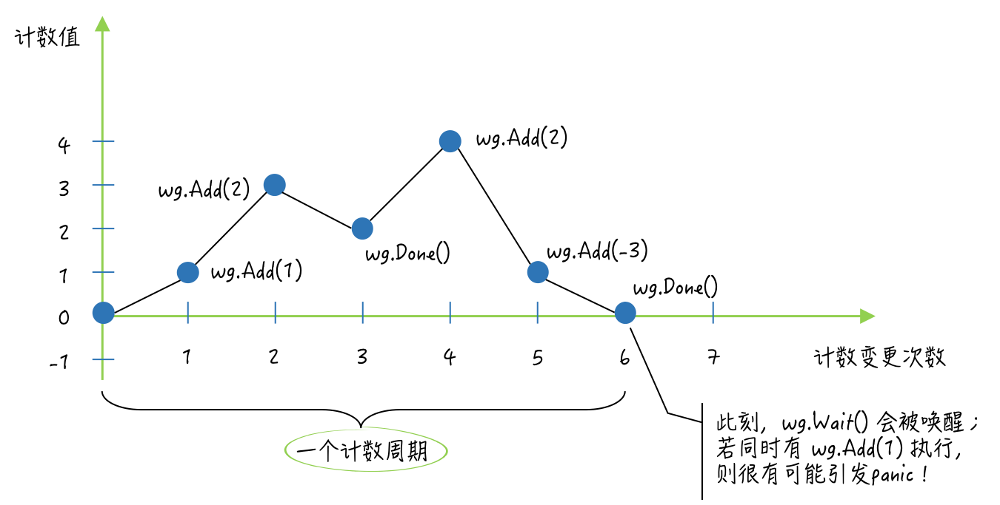

# Add 的时机，以及 wg.Go(func())

sync.WaitGroup 类型的值可复用(用到了原子操作，但未用到互斥锁)，且开箱即用。

WaitGroup 的基本原则是：先`Add` 登记任务，再启动任务，再`Wait` 。所以在启动任务的函数里 Add(1) 是不太好的操作，即使启动的任何数量不能提前确定，也应在每次启动任务之前 Add(1) 。Go 1.25+ 还有更推荐的写法：`WaitGroup.Go` 。它把`Add(1)` 和`go` 绑定在一起，避免写错顺序：

```go
var wg sync.WaitGroup

wg.Go(func() {
    doWork()
})

wg.Wait()
```

当计数器为 0 时，首次正数`Add` 必须发生在`Wait` 之前；否则`Wait` 可能直接返回，导致任务漏等。在某些并发复用场景下，还可能触发`WaitGroup misuse` panic。

```go
var wg sync.WaitGroup

wg.Add(1)

for i := 0; i < 1000; i++ {
    go wg.Wait()
}

time.Sleep(time.Millisecond)
wg.Done()

// 错：上一批 Wait 可能还没返回，就开始下一轮 Add。可能触发：panic: sync: WaitGroup is reused before previous Wait has returned
wg.Add(1)
wg.Done()
```



# sync.Once.Do(func())

sync.Once 开箱即用，但不可复用（因为含 sync.Mutex 类型字段 m，另外还有一个底层类型为 uint32 的原子类型 done atomic.Bool）。

该方法的功能并不是对每一种参数函数都只执行一次，而是只执行“首次被调用时传入的”那个函数，并且之后不会再执行任何参数函数。所以，如果你有多个只需要执行一次的函数，那么就应该为它们中的每一个都分配一个sync.Once类型的值（以下简称Once值）。

即是：**对于一个 once 变量，once.Do(func()) 不只是 func() 只执行一次，而是所有的 once.Do() 调用只执行一次！**

**once.Do() 不仅保证多次调用只执行一次任务，还保证 Do 返回的时候任务确实执行完了（不管是自己还是别人执行完的）！**

```go
type Once struct {
	_ noCopy
	done atomic.Bool
	m    Mutex
}

func (o *Once) Do(f func()) {
	if !o.done.Load() { // 快路径/快速失败路径，用原子类型可以避免在这里加锁
		o.doSlow(f)
	}
}

func (o *Once) doSlow(f func()) {
	o.m.Lock()
	defer o.m.Unlock()
	if !o.done.Load() { // 慢路径，与快路径一起组成“双重检查”
		defer o.done.Store(true)
		f()
	}
}
```

Do方法在功能方面的两个特点：
1. 由于Do方法只会在参数函数执行结束之后（而不是之前）把done字段的值变为1，因此，如果参数函数的执行需要很长时间或者根本就不会结束（比如执行一些守护任务），那么就有可能会导致相关 goroutine 的同时阻塞（多个goroutine 对 Do 的调用不会重复执行 func，但会1个执行，剩下的阻塞、“围观”直到唯一的一个执行完成，以**保证 Do 的任意一次调用返回时，都确实是因为 done 为 1**，以保证所有 goroutine 后续代码所依赖的前提正确）。

> 例如，有多个 goroutine 并发地调用了同一个Once值的Do方法，并且传入的函数都会一直执行而不结束。那么，这些 goroutine 就都会因调用了这个Do方法而阻塞。因为，除了那个抢先执行了参数函数的 goroutine 之外，其他的 goroutine 都会被阻塞在锁定该Once值的互斥锁m的那行代码上。

2. Do方法在参数函数执行结束后，对done字段的赋值用的是原子操作，并且，这一操作是被挂在defer语句中的。因此，不论参数函数的执行会以怎样的方式结束，done字段的值都会变为1。

> 也就是说，即使这个参数函数没有执行成功（比如引发了一个 panic），我们也无法使用同一个Once值重新执行它了。所以，如果你需要为参数函数的执行设定重试机制，那么就要考虑Once值的适时替换问题。

在很多时候，我们需要依据Do方法的这两个特点来设计与之相关的流程，以避免不必要的程序阻塞和功能缺失。
