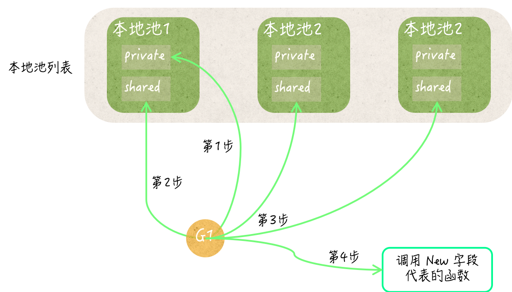

# sync.Pool 是什么

> `sync.Pool` 是性能优化工具，不是默认的数据结构。引入前后应使用 benchmark 比较 `allocs/op`、`B/op` 和执行耗时，确认它确实带来了收益。

`sync.Pool` 是一个并发安全的、用于复用**临时对象**的对象池。它的主要作用是减少高频创建临时对象产生的内存分配和 GC 压力。

适用对象：每一个值都是独立的、平等的、可相互代替和可重用的。

典型使用场景包括：

- 复用 `bytes.Buffer`；
- 复用临时的 `[]byte`；
- 复用编码器、解码器等创建成本较高，但可以被安全重置的临时对象。

`sync.Pool` 的零值可以直接使用：

```go
var pool sync.Pool
```

它只有两个主要方法和一个可选字段：

```go
type Pool struct {
	New func() any
}

func (p *Pool) Get() any
func (p *Pool) Put(x any)
```

- `Get()` 从池中**取出并移除**一个任意对象。池为空时，如果设置了 `New`，就调用 `New` 创建对象；否则返回 `nil`。
- `Put(x)` 把对象放回池中。`Put(nil)` 不会产生任何效果。
  -  Put 技术上允许放入不同类型。但通常约定一个池只存一种具体类型，不同类型应使用不同的`sync.Pool`。否则：
     - `Get()` 返回任意对象，类型断言可能 panic；
     - 重置和归还逻辑难以统一；
     - 不同尺寸、生命周期的对象会相互干扰。
   - 只有调用方统一按某个接口处理时，才可能存放不同具体类型。
- `New` 应当只负责创建对象，不要在并发调用 `Get` 时修改它。

`Get` 和 `Put` 使用 `any`，所以调用方通常需要做类型断言。

同一个池中应只存放同一种类型的对象。`New` 通常返回指针类型，既能统一类型断言，也可以避免把非指针值放入接口时产生额外的分配。

# 基本用法

下面使用 `sync.Pool` 复用 `bytes.Buffer`：

```go
package main

import (
	"bytes"
	"fmt"
	"sync"
)

const maxPooledBufferCapacity = 64 << 10 // 64 KiB

var bufferPool = sync.Pool{
	New: func() any {
		return new(bytes.Buffer)
	},
}

func buildMessage(name string, count int) string {
	buffer := bufferPool.Get().(*bytes.Buffer)
	buffer.Reset()

	defer func() {
		// 仅将小对象放回池中复用底层内存，避免偶发的大对象被池长期持有。
		if buffer.Cap() <= maxPooledBufferCapacity {
			buffer.Reset()
			bufferPool.Put(buffer)
		}
	}()

	fmt.Fprintf(buffer, "name=%s count=%d", name, count) // 这里可能会扩大 Buffer

	// 转为 string 会得到独立的结果，这样返回后才能让别的使用方安全地复用 buffer 而不影响已方。
	return string(buffer.Bytes())
}

func main() {
	fmt.Println(buildMessage("task", 10))
}
```

标准使用流程是：

1. 调用 `Get` 取得对象；
2. 将对象重置为干净状态；
3. 独占使用该对象。Get 时从池中删除了对象，但“独占”仍是使用约定，不是锁保护，以下情况仍会破坏独占：
   1. 同一个对象被`Put` 多次；
   2. `Put` 后继续使用对象；
   3. 归还前把对象引用交给其他 goroutine。
4. 使用完成后再次重置；
5. 调用 `Put` 归还对象。

这里在使用前和归还前都调用了 `Reset`：

- 使用前重置，可以防御上一次使用者没有正确清理对象；
- 归还前重置，可以避免对象在池中仍保留上一次使用的逻辑状态。对于包含指针、切片或 map 字段的自定义对象，还应主动清空不再需要的引用。

不过，`bytes.Buffer.Reset()` 只会把长度置为 0，不会清零底层字节。因此，涉及密码、Token 等敏感数据时，不应只依赖 `Reset`。

# Get 到的对象由当前调用方独占

`sync.Pool` 自身可以被多个 goroutine 并发调用，但从池中取出的对象不一定是并发安全的。

`Get` 会把对象从池中移除。调用方取到对象后，应当独占使用它；只有不再使用时，才能将它放回池中：

```go
buffer := bufferPool.Get().(*bytes.Buffer)

// 当前 goroutine 独占使用 buffer。
use(buffer)

// use 返回后不再访问 buffer，才可以归还。
buffer.Reset()
bufferPool.Put(buffer)
```

下面的写法是错误的：

```go
buffer := bufferPool.Get().(*bytes.Buffer)
data := buffer.Bytes()

bufferPool.Put(buffer)

// 错误：buffer 已经可能被其他 goroutine 取走并修改，
// data 仍然引用着 buffer 的底层数组。
consume(data)
```

`Pool` 保证的是 `Get`、`Put` 操作并发安全，不会自动让池中对象变成并发安全对象。

# Pool 不是可靠缓存

池中的任何对象都可能在任意时刻被自动移除，而且不会通知调用方。因此：

- `Put` 进去的对象，不保证以后一定能 `Get` 到；
- 不能用 `sync.Pool` 保存必须存在的数据；
- 不能依赖池中对象的数量；
- 不能把它当作有容量保证的普通对象池、连接池或缓存。

下面的逻辑是不可靠的：

```go
pool.Put(value)

// 错误：不能假设下一次 Get 一定返回 value。
got := pool.Get()
```

`Get` 只保证返回池中的某个任意对象，或者在池为空时调用 `New`。它不保证先进先出、后进先出，也不保证返回当前 goroutine 之前放入的对象。

# Pool 与 GC 的关系

`sync.Pool` 的目标是：系统繁忙时复用大量临时对象，系统空闲并发生 GC 后允许这些对象被回收。

以当前 Go 1.26 的实现为例，池内部主要有两代缓存：

- `local`：当前 GC 周期使用的主缓存；
- `victim`：上一个 GC 周期留下的备用缓存。
- `local` 和 `victim` 各自指向一组 `[P]poolLocal`。

开始新一轮 GC 时，运行时大致会执行：

1. 丢弃更早一轮 GC 留下的 `victim`；
2. 把当前 `local` 移到 `victim`；
3. 清空当前 `local`。

因此，一个对象即使已经 `Put`，也可能在后续 GC 中被丢弃。两代缓存是当前实现为了提高复用率所做的优化，不是调用方可以依赖的 API 承诺。对外语义仍然是：**池中的对象随时都可能消失**。

这也是为什么 `sync.Pool` 通常要设置 `New`：

```go
var bufferPool = sync.Pool{
	New: func() any {
		return new(bytes.Buffer)
	},
}
```

这样即使 GC 清空了池，`Get()` 仍然能取得一个可用对象。

# 为什么并发性能较好

当前实现会按照调度器中的 P，为每个 `Pool` 建立本地缓存。每个 P 对应的本地缓存主要包含：

```go
type poolLocal struct {
	poolLocalInternal
	pad [...] // 防止伪共享的填充字段
}

type poolLocalInternal struct {
	private any
	shared  poolChain
}
```

- `private`：只供当前 P 使用，访问时不需要竞争：一个 P 同时只执行一个 G，并且访问`private` 期间 G 不会被抢占(即被调度器换下、执行同P的其他G)或G迁移到其他 P，因此两个 G 对该 P 的`private` 访问会被调度器自然串行化。
- `shared`：当前 P 可以从头部放入、取出对象，其他 P 可以从尾部偷取对象。对 shared 的访问通过原子操作实现无锁并发安全。

`Put` 的大致流程是：

1. 找到当前 P 对应的本地缓存；
2. 如果 `private` 为空，就放入 `private`；
3. 否则放入 `shared`。

`Get` 的大致流程是：

1. 当前 local:
   1. 优先取当前 P 的 `private`；
   2. 再取当前 P 的 `shared`，从头部 popHead;
   3. 尝试从其他 P 的 `shared` 偷取，从尾部 popTail。
2. 尝试从上一轮 GC 的 `victim` 中获取；
   1. 当前 P 的 `private`；
   2. 当前 P 的 `shared` **popTail**;
   3. 其他 P 的 `shared` popTail。
3. 仍然没有对象时，调用 `New` 或返回 `nil`。

操作本地缓存时，运行时会短暂地将当前 goroutine 与 P 绑定（G不跑，P也不换G），以确保找到的本地缓存不会在操作过程中发生变化。

这套设计让大部分 `Get`、`Put` 都只访问当前 P 的本地数据，减少了多个 goroutine 竞争同一把全局锁的情况。

图示（缺少 local -> victim 的上层顺序）：


# 不要复制已经使用过的 Pool

`sync.Pool` 第一次使用后不能再被复制：

```go
type BufferCache struct {
	pool sync.Pool
}

func (c *BufferCache) Get() *bytes.Buffer {
	return c.pool.Get().(*bytes.Buffer)
}
```

包含 `sync.Pool` 的结构体也应通过指针传递：

```go
func useCache(cache *BufferCache) {
	// ...
}
```

不要在 `Pool` 已经使用后按值复制整个 `BufferCache`。复制会把内部状态拆成多个不一致的副本，行为不可预期。`go vet` 可以通过 `noCopy` 标记帮助发现部分错误复制。

# 复用切片时优先存切片指针

将 `[]byte` 直接赋给 `any` 接口，可能产生额外的装箱开销。高频场景可以在池中保存 `*[]byte`：

```go
const defaultBufferSize = 4 << 10 // 4 KiB

var byteSlicePool = sync.Pool{
	New: func() any {
		buffer := make([]byte, defaultBufferSize)
		return &buffer
	},
}

func handle() {
	bufferPointer := byteSlicePool.Get().(*[]byte)
	buffer := (*bufferPointer)[:defaultBufferSize]

	// 使用 buffer。

	*bufferPointer = buffer[:defaultBufferSize]
	byteSlicePool.Put(bufferPointer)
}
```

这里仍需注意两点：

- 归还后不能继续使用 `buffer`；
- 如果操作过程中切片扩容得非常大，应限制可归还的容量，避免池持有超大数组。

# 内存模型保证

如果 `Put(x)` 放入的对象 `x`，后来恰好被某次 `Get()` 返回，那么：

```text
Put(x) synchronizes before Get() 返回同一个 x
```

类似地，如果 `New` 创建的 `x` 被 `Get` 返回，那么 `New` 中对 `x` 的初始化也发生在调用方使用 `x` 之前。

因此，调用方在 `Put` 之前对对象做的修改，对后来取得同一个对象的调用方可见。不过，这并不意味着对象归还后还能继续访问；一旦调用 `Put`，对象的所有权就交回了池。

# 什么时候适合使用

适合使用 `sync.Pool` 的情况：

- 对象只是临时工作区，不承载业务状态；
- 对象创建频繁，已经成为明显的分配或 GC 热点；
- 对象可以被完整、低成本地重置；
- 多个互不依赖的并发调用都需要这类对象；
- 对象丢失后可以随时重新创建。

不适合使用的情况：

- 必须限制数量的数据库连接、网络连接等资源；
- 需要保证对象一定能再次取到；
- 对象包含无法可靠重置的状态；
- 对象很小，创建成本低；
- 对象只在一个短生命周期结构体内部使用，复用次数很少；
- 没有通过 benchmark 或性能分析确认内存分配确实是问题。

`sync.Pool` 是性能优化工具，不是默认的数据结构。引入前后应使用 benchmark 比较 `allocs/op`、`B/op` 和执行耗时，确认它确实带来了收益。

# 常见错误总结

1. 把 `sync.Pool` 当作可靠缓存，假设放进去的对象不会丢失；
2. 对象尚在使用时就提前 `Put`，导致多个 goroutine 同时修改同一对象；
3. 归还对象后，继续使用它或它内部切片、指针等引用；
4. 没有重置对象，让上一次调用的状态污染下一次调用；
5. 不限制可归还对象的大小，导致池持有偶发的超大内存；
6. 复制已经使用过的 `Pool`；
7. 用它管理必须关闭、数量必须受控的外部资源；
8. 未经性能测试就在普通代码中大量引入对象池。

最核心的使用原则是：

> `sync.Pool` 只复用可随时丢弃、可重新创建、可彻底重置的临时对象。调用方从 `Get` 到 `Put` 期间独占对象，调用 `Put` 后不再访问它。
