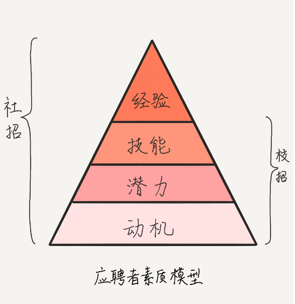

信任感使你能预测对方将来的行为。

# 应聘者素质模型

- 经验（Experience）：“3年Java开发经验”

- 技能（Skill）：“精通 Java 多线程编程”

> 面试官希望，你库存的经验技能，与职位的要求匹配度越高越好，也就是所谓的“对口”。
> - “库存”不足，自然不能满足工作需求。
> - 但假如你的“库存”大过了该职位的问题域，公司需要提供“多余”的薪水，而且如果那部分超出的经验和技能，公司又用不上，就成资历过剩了，这时公司会有两点顾虑：一是公司提高了用人成本，二是员工屈才，工作稳定性不好。

- 潜力（Potential）：增长经验和技能的能力。面试官可以通过考察应聘者的学习、创新和精益能力来做判断。
  - “学习”指的是从不会到会，掌握一项技能的过程；
  - “创新”是针对特定场景创造新事物的技能；
  - “精益”是把事情越做越好的技能。

> 如果你承认潜力，那么就说明你有成长型思维，有成长思维的人认为：技能是可以通过努力获得的，关键是要保持好奇心，平时爱思考、总结、尝试，愿意接受挑战，不怕错误和失败。因此，要在潜力上为自己的面试效果加分，你就需要注意如何在言谈及简历描述中体现这些特质。

- 动机（Motivation）：做事情的内心目标、意愿和态度。很多事情我们不是没有能力做，而是被不想做、觉得困难等心理因素扯了后腿，这就是动机不足。“动机”决定着应聘者的潜力发挥、技能习得和经验形成，也就是说，动机决定着素质模型上面的三层。三类动机员工：
  - 自燃型，也就是自我驱动的员工，他们做事动机强烈，目标明确，明白任务的意义，甚至自己寻找有意义的事，满怀激情地投入，往往超出自己的工作范围，去推动进展，取得成果，然后又奔向下一个目标。
  - 点燃型，这类员工需要一定的激励，需要他人帮助才能找到目标和意义，一旦“激活”就能像自燃型员工一样奋力工作。
  - 阻燃型，这类员工当一天和尚撞一天钟，给多少钱，干多少活，按工作的最低标准和最后完成时间递交任务，跟同事合作差，不乐意分享，自我保护。

# 公司到底想要什么样的人呢？

我们从应聘者素质模型可以看出：
- 动机方面，公司更想要人品好，职业价值观和团队文化一致，职业性格和职位匹配的候选人；
- 潜力方面，公司更想要学习、创新和精益能力好的候选人；
- 技能和经验方面，公司想要和职位需求匹配的，如果你资历过剩，就要看公司发展需要了，如果你资历不够，那就要看你的潜力和动机了。
