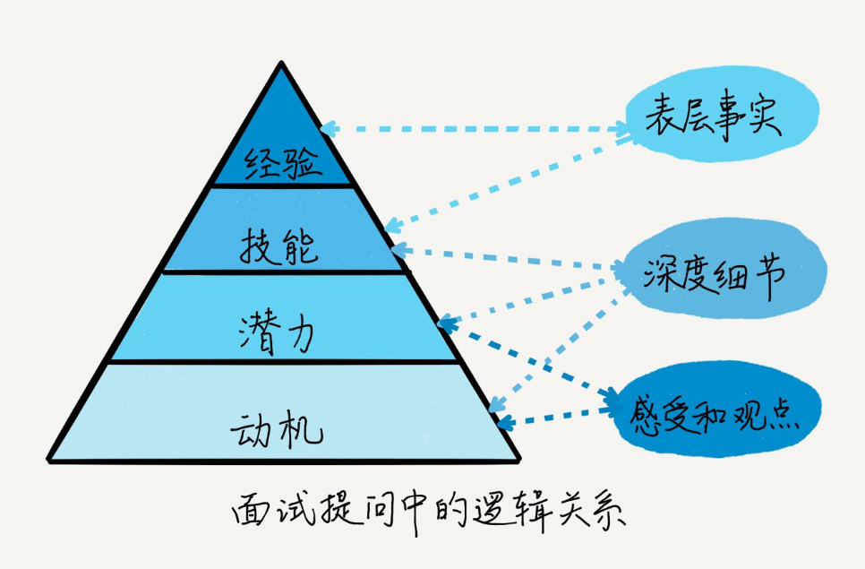

# 面试考查的范围和目的

不同的面试形式，虽然对你的能力表现有不同程度的限制，但是考查范围其实大致相同，也就是第一篇里提到的应聘者素质模型的四项内容：经验、技能、潜力和动机。不同职位和团队，对这四项内容有不同的要求；不同场次的面试官角色不同，对这四层进行考查的侧重点也会不同。

什么情况下，面试官会判定一个应聘者面试失败呢？有两种情况：一、发现他不适合；二、不清楚他是否适合。也许，你会觉得第二种情况有点不通情理，“如果一次面试没搞清楚人家的能力，难道不该再安排一场吗？这样难道不是面试官的问题吗？”其实不然。有些被拒绝的应聘者，其实并没有被发现致命的缺点，只是没有被发现突出的优点而已。当然，不够资深的面试官，采用的面试方法和问题可能不够恰当，导致看不清应聘者的能力，**但他的补救方法通常是把精力转到下一个候选人身上**，除非没有其他候选人了。

所以，**应聘者需要有意识地寻找机会，主动向面试官展示自己的能力，而不要仅以面试官的提问为纲**。

# 考查能力的方法

## 观察

第一印象还是很重要的

## 提问

### 按图索骥

在审视简历时，会粗略地给应聘者一个能力定位：经验技能是否和职位对口，是否有潜力发展更多技能，是否在动机方面存在问题。然后:
- 找出值得肯定的点：需要在面试中进一步**验证**。
- 找出否定或者存疑的点：必须在面试中**排除**。

这些“点”，就构成了初始问题列表。

面试官的提问，并非按照简历的内容逐条进行，而是选择与职位要求有关的，来做验证或排除。

### 随机抽样

尤其在考查知识技能时，这个方法应用最多。要考查的能力点很多，一般面试官会先把它们归类，然后在每类中抽一两个典型问题出来。如果应聘者的回答暴露了不足，面试官会多扩展一下那个问题域，验证一下是否整类能力存在问题。

> 如果你一个知识点没回答上来，不要慌，寻找自己的知识体系中，与之最相关的一类，告诉面试官，**避免面试官仅以一个点的不足误认为你整块技能不够**。

### 问题之间是有逻辑关系的

#### 表层事实

“扫描”你的知识面和经验范围，而不是马上就想进入细节。比如“你会写 SQL 查询吗？”

这层问题的回答，就要**简洁精炼**，不要有过多的细节，否则你会显得抓不住重点。

#### 深度细节

在面试官基本了解了你的经验面和技能体系之后，就要挑一些职位需要的关键技能问深度细节了。比如：“能说下你做过的数据库调优细节吗？”“还有什么呢？”“这个的复杂性是什么？”“你这个做法有什么创新吗？”

这些问题的一个基本原则是：基于过去的行为（行为面试法）。你也要用经历去作答。一般的回答，是只停留在原则上，而让人眼前一亮的回答，是会用**具体事例描述细节**的。这样面试官才能了解你真正的做法、想法、质量，而不是认为你在照本宣科。

在细节的描述上，可以使用 START 法则，即 Situation（情景）、Task（任务）、Action（行动）、Result（结果）和 Thinking（反思）。

> 可能的“拷打“：比如，毫不留情地指出你的错误做法和不良影响，考查你在被挑战的情况下，能否保持冷静、理性作答；他还可能故意装作没听懂或者没记住的样子，让你重新再讲一遍，验证你的表达有没有进步，前后说法是否一致；很多情况下，面试官为了真正测试出你某项技能的极限，会一直问到你回答不上来为止。所以，即使有些问题你没回答上来，并不表示你不合格，这只是正常的能力测试而已。

#### 感受和观点(T)

事后的总结和改进有没有到位，是否具有成长型思维。比如“这段经历你感觉最折磨人的地方是什么？”“你满意这个方案么？” “你学会了什么？”“为什么你当时要接手这个任务？”“你怎么评价你的队友？”

这类问题很难回答。你的回答会包含大量的价值观、性格品质等信息，如果之前没有总结过的话，你的回答可能没有深度，而且如果只是表态的内容（比如“我为了团队愿意做任何事”），没有事例去讲的话，也不会让面试官感动和信服。

### 问题背后的意图

碰到古怪的或者出乎意料的问题，不要意外，可以利用前面的问题和自己的表现，分析为什么面试官问这个问题，以及这个问题的意图是什么。

比如，面试官在你回答完一系列关于项目成果的问题之后，突然问你：“你觉得你的同事能力如何。”你如实回答：“他们比我早进入项目 2 年，经验丰富，能力很强。”然后面试官开始追问你：“那刚才那些项目成果有多少是你独立完成的？”你恍然大悟：刚才在表述成果时，说的都是你做出了什么，面试官怀疑你把别人的功劳说成了你的。如果在回答项目成果时，加上和同事合作的说明，就不至于被面试官追问了。
