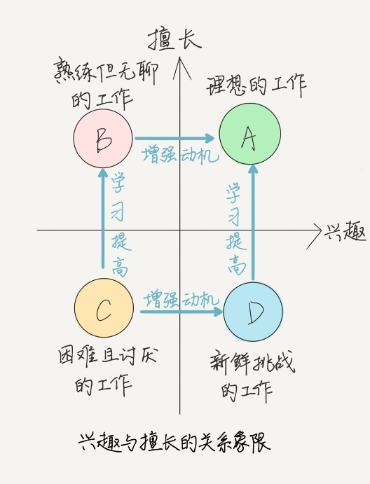
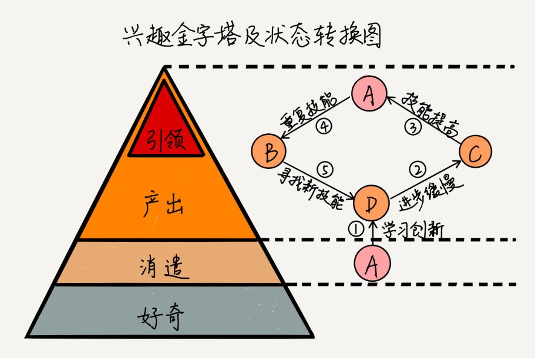

感兴趣的，我们有意愿做好；擅长做的，我们有能力做好。

不仅是在兴趣和擅长中做选择，更重要的是，要有能力促使兴趣和擅长的发展，**将不感兴趣的，发展成兴趣**；**将不擅长的，发展为擅长。**

意愿和能力会随着工作的内容和难度的变化互相影响：当前不擅长的，将来会因为兴趣而擅长；当前不感兴趣的，将来可能会因为擅长而感兴趣。

# 兴趣和擅长的关系

兴趣和擅长之间是互相联系，互相影响的。

同样的工作，可能会随着时间而发生坐标位移：
- 动机会影响你的兴趣强弱。缺少动机，兴趣减弱，条目会在坐标系中左移；增强动机，兴趣增强，条目会右移。
- 通过有效学习，工作项会上移。

# 不同等级的兴趣

好奇：还不是真正的兴趣。好奇会驱动你付出行动，但是当你真正体验到该工作的辛苦和快乐之后，要么好奇消失，放弃体验；要么对下一层未体验的工作产生好奇，让你进一步尝试。

消遣：兴趣的初级阶段，即反复做喜欢的事，目的是为了享受愉悦。这个阶段不需要太高的技能，也不需要付出太大的努力，就能收获愉悦的体验。

产出：产出层的兴趣带来有价值的产出，而不仅仅是感官上的消遣。这需要你付出更多的努力，掌握此兴趣领域中更高的技能，从而做出有区分度的产出。**要想进入产出层，需要勤学苦练、坚持不懈，讲究学习方法。这时的兴趣，才达到稳定，成为你的擅长。**

引领：指技能已经在该兴趣领域达到顶级，开创出新的技能和体验，从而引领一批人或该领域的发展。比如某些摄影大师的作品，开创了新的摄影手法和题材，引发大众去学习效仿。这层也是产出层的一部分，是产出层的高级部分。

选择兴趣或擅长，不能只看当前的状态。要发展到产出层看，而不是只在好奇层和消遣层，这是因为**产出层的兴趣和擅长（包括引领层）才是稳定的、深刻的，对你有重要意义的**。

