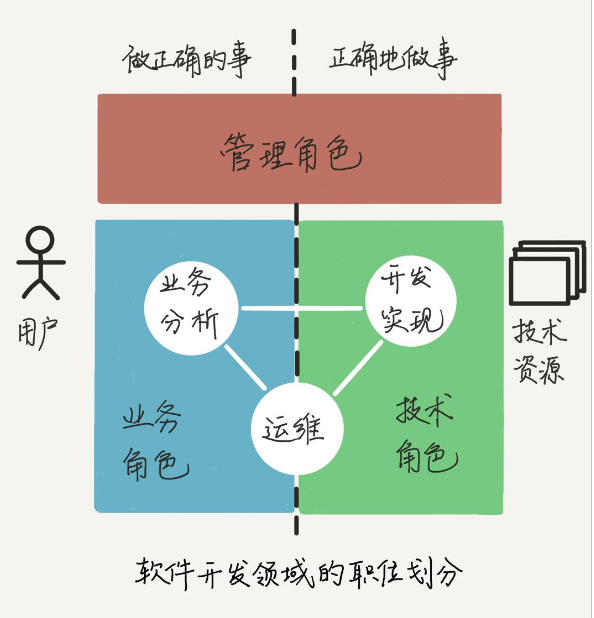

软件产品团队的三种角色，每个人都是三种角色的
- 技术角色：关注技术和逻辑实现，可发展为“T”型人才，需要有对技术的钻研和敏感性。
- 业务角色：关注用户和价值，有同理心。把用户价值翻译成产品功能，保证产品团队做正确的事。优秀的业务角色能够换位思考，就是有同理心，能站在用户角度考虑问题，也能站在技术人员的角度理解问题。
- 管理角色：关注过程质量，有条理。

技术角色有以下的四个发展阶段：
- 初级的程序员，拿到小的开发任务，能够运用团队中已经选型的技术和工具，编码实现功能，通过调试代码，理解技术的原理，训练自己的思路以便和计算机的运行逻辑同频，灵活运用编程模式，驽驾程序解决技术问题，也就是形成**算法思维**，这时他关注的是代码质量和技术问题。
- 随着开发任务的多样化，程序员解决的问题越来越深入和复杂，逐渐接触和掌握了完整的框架和技术，通过总结，对该问题域形成模块化、体系化的认知，可以独立设计和开发，也就是形成**系统思维**。这时他关注的是某一类系统的运行效率。
- 解决问题能力越来越强的程序员，把问题域不断拓展到新的领域，利用已经掌握的系统化知识和思考方法，能快速学习新领域的知识，掌握新领域的技术和框架，这是进行“T”型技术中广度的积累。每个技术模块都形成他知识体系中的一个节点，随着这个知识体系越长越大，他可以根据用户的需求，选择合适的技术模块，进行分拆组合，考虑成本和收益的均衡，来提供解决方案，也就是形成**架构思维**，我们称为架构师。这时架构师的他，关注的是业务和架构的最优匹配。
- 再以后，就是对技术前瞻性的把握了，结合市场的需求变化和研究人员的成果，依托整个软件生态的发展，引入或创造新的技术，提高应用效率，满足用户需求。

技术是可以一直做下去的！和年轻的开发者相比，你资深在对技术本质和广度的理解，以及技术和业务的融合上。

能不能做好技术，不在于你是不是计算机科班出身，不在于你是不是现在还处理琐碎的小任务，而在于你**对底层细节的好奇心**，以及是否愿意尝鲜钻研，扩充自己的知识体系。

尽管管理者们的管理风格多种多样，但是有一个基本的特质是：有条理（Organized），也就是善于安排事情的**优先级**和组织过程，目的是保持秩序，使过程可控。即使还没有管理的头衔，就日常的事情来说，你是否趋向“有条理”呢？比如，你习惯把常用的东西放到固定的位置么？你会按照使用场景优化它们的位置么？你正忙的时候接到一个新任务，是否先衡量一下**轻重缓急**，再决定要不要切换任务呢？如果是，说明你比较有条理，可以发展下管理意识。

