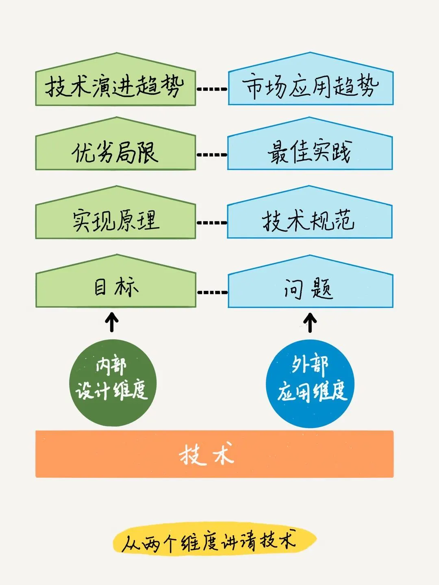

给面试官讲明白技术，你不仅要懂技术，还要懂面试官。

# 技术可以从哪些维度来讲

对于一项流行的技术，大部分人可以讲清实现原理和技术规范，也就是说能搞懂它的工作原理和使用方法，这是技术人员的基本功。

再上面的技术局限性和最佳实践，只有经过深入的钻研，甚至读源码，以及多场景的实践之后，才能讲出深刻的认识。

对于最上面的趋势层，需要具有相当程度的“T”型技术体系，对相关技术有横向和纵向的对比之后，才能总结得出来，考验应聘者的知识面和洞见。
> 如果有人恰好读过几篇有深度的技术文章，上面的某些层他也可能照本宣科地讲出来。那么让你和他可以区分开的“杀手锏”就是技术实战：如果你在“最佳实践”部分中，能结合自己的项目经历，找到该技术的一个应用例子，特别是棘手的问题，讲清你是如何调优或者解决的，不仅会彰显你真实的技术水平，而且最有说服力，也是面试官最看重的。当你把问题的解决过程，跌宕起伏地讲出来，面试官也会跟你一样嗨起来。

难道面试中的每个技术问题，都要按照上面两个维度八个方面去解释么？不是的，你还需要弄懂面试官想听什么，能听什么，然后再**按需呈现**。

## 外部：应用维度

### 干什么用：解决的问题

### 怎么用：技术规范

这需要了解接口和关键字的使用规则和潜在影响，以及各功能的细微差别。

### 怎么用好：最佳实践

把技术运用到多种不同的场景时，会发现同样的使用方法，会有不同的效果，这是因为问题上下文不同了，该技术有不同的适应面。从而你可能踩了很多坑，知道了该技术的“脾性”，从中总结出最佳实践。这缘于在不同应用场景中，对技术表现差异的比较和把握。

最佳实践回答“怎么能用好”的问题，反映你实践经验的丰富程度。

### 谁用，用在哪：市场趋势

随着技术生态的发展，和应用问题的变迁，技术的应用场景和流行趋势会受到影响。

这层回答“谁用，用在哪”的问题，反映你对技术应用领域的认识宽度。

## 内部：设计维度

## 目标

为了解决用户的问题，技术本身要达成什么目标。比如，Java 多线程要在优先级调度、锁、信息同步等方面达成怎样的目标，才能更好地实现并发。这层定义“做到什么”。

## 实现原理

为了达到设计目标，该技术采用了什么原理和机制。Java 多线程的实现原理包括内核线程、使用用户态线程、使用用户态线程加轻量级进程混合等部分，还包括硬件指令集、Test and Set、各种锁等。实现原理层回答“怎么做到”的问题。把实现原理弄懂，并且讲清楚，是技术人员的基本功。

## 优劣局限

每种技术实现，都有其局限性，在某些条件下能最大化的发挥效能，缺少了某些条件则暴露出其缺陷。比如在 Java 多线程编程中，采用共享内存的方式，锁的开销比较大，程序员编程难度较大，容易出错，难以调试。优劣局限层回答“做得怎么样”的问题。对技术优劣局限的把握，更有利于应用时总结最佳实践，是分析各种“坑”的基础。

## 演进趋势

技术是在迭代改进和不断淘汰的。了解技术的前生后世，分清技术不变的本质，和变化的脉络，以及与其他技术的共生关系，能体现你对技术发展趋势的关注和思考。这层体现“未来如何”。比如：
> Java 5 提供 JCU 包，实现了多种锁结构，简化开发；Java 7 加入 Future 来获取线程返回值；Go 语言中“协程”的概念，也被第三方引入，扩展了 Java 的多线程功能，比线程切换更快，性能得到了很大的提升。

# 面试官想听什么

应聘者并不能准确理解面试官想要听的点的几种情况及解决办法：

- 问答双方角色不同，思考角度不同，导致对同一个技术话题，展开的方向不同，自然理解上会发生分歧。
  - 工程思维的人想的是如何得到结果，你可以着重讲技术内部维度的内容；
  - 而用户思维的人想的是那个结果可以用来干什么，你就要侧重到应用维度上了。

- 问答双方的知识结构和水平不一样，理解深度和宽度不同：这需要你了解对方的技术水平，采用适当的技术语言或者业务语言来表达。

- 上下文理解不同，面试官的问题意图不能被应聘者理解：面试官的问题之间或多或少是有联系的，你需要根据问题的上下文，结合前面问答中面试官的语言或者肢体反馈，分析他的意图，搞清他是在问“为什么”，还是“是什么”，或者“怎么用”，从而调整要表达的内容。

- 面试官没有问清楚、具体：从面试官的语言和关注点上，推测他的角色、知识结构、沟通风格，回忆最近几个问题的关系，来推测问题意图。如果推测不出来，就直接问他：“充分沟通”。

# 注意表达方法

1. 结构化表达，帮助面试官梳理信息逻辑。比如，使用列表，或者使用结构化的语言序号“第一……第二……”。

2. 可视化。用画图或者演示的方法，直观形象地表达复杂的技术问题。

3. 举例子和做类比。
- 举常见的例子，类比成常见的事物，这样把高深的原理说简单，对方不仅能听懂，还会赞赏你的表达能力。
- 把内容陈列出来容易，但是长话短说很难。这需要你深刻理解本质，区分每块内容的重要等级，再梳理逻辑和分析取舍。

4. 对比。

5. 讲故事。如果你能找到一段相关经历，讲述该技术的应用或者学习细节，展示你学以致用的能力，效果会非常好。你可以说“这个技术，我上个月正好在某某项目上用过，当时的情况是……”

以上这些表达方法，不仅适用于技术，在其他专业问题上，也同样见效。但是请注意，回答时一定注意详略。如果你在某一个问题上纠缠太久，会影响后面知识点的考查。你需要边讲边注意面试官的反应，如果他有看表、看简历等厌倦或者着急的情绪信号，就要赶紧调整到下一点了。
