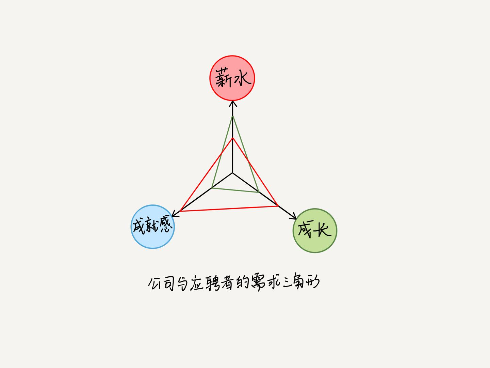

如果 HR 在第一次面试时，就问你期望的薪水，你如何作答呢？“我相信公司在有自己的薪酬体系和制度，对于薪酬这一块可以按公司的薪酬制度去执行，根据实际工作量和难度来决定。”

面试的重点，还是要放到下面这些关键问题上：如何展示你的能力，让面试官相信你能解决他想解决的问题，你能为公司实现别人做不了的价值。这样一来，拿到如意的薪水，就是水到渠成的事情了。

HR 负责制定和维护公司的薪资结构；而职能经理有权决定你的职位级别，以及在该级别规定的薪水区间决定你的薪水。

职能经理最熟悉团队的薪资分布，最理解工作的价值轻重，并且负责激励和管理团队，所以对薪水有决定权。虽然 HR 负责整个公司的薪酬体系不被打破，但是对于特别优秀的人才，职能经理可能会给他调整到更高技能要求的职位，从而也就提高了他的薪水。

怎么谈薪：强调你能为公司做什么，带来什么价值。
