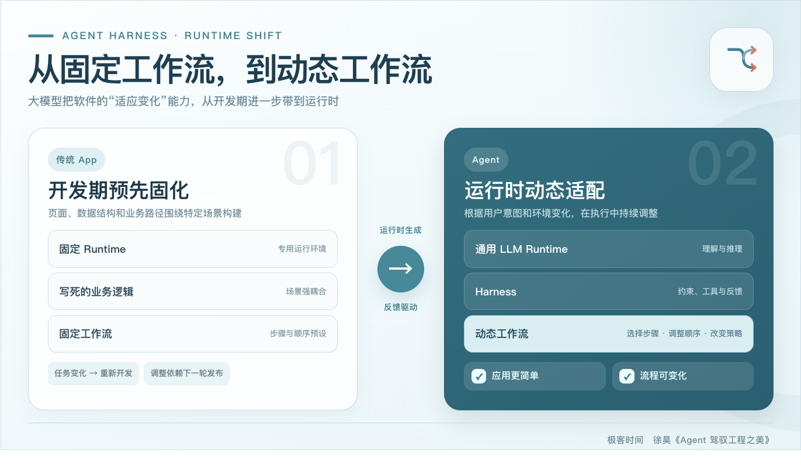

# 一、Agent = LLM + Harness

大模型天然擅长理解、思考和推理，但仅有思考能力还不足以完成复杂任务。它需要 Harness 帮助自己接收上下文、规划行动、调用工具、观察结果、保存状态，并在必要时进行校正。只有这两部分结合起来，Agent 才能从“会回答问题的模型”变成“能够持续完成任务的系统”。

传统：App = Runtime + Business Logic。传统软件把运行时环境和业务逻辑结合起来：运行时负责执行，业务逻辑规定软件在不同条件下应该做什么。把两个公式对应起来，就会发现，大模型正在扮演一种通用 Runtime，而 Harness 承担了相当一部分业务逻辑、软件架构和软件设计的职责。

# 二、LLM 作为通用运行时，带来两项关键变化

## 应用逻辑被大幅简化

当大模型成为通用运行时后，很多过去必须显式编码的分支与循环，可以由模型根据语义和现场信息动态推断。开发者不必为每种情况都提前写死处理路径，应用中的大量定制逻辑因此有机会被简化。

这并不是说代码会完全消失，而是说，软件不再只能依靠确定性的代码描述行为。自然语言指令、上下文、工具和验收标准，也可以成为软件行为的一部分。

## 固定工作流变成动态工作流

# 三、Harness 既是软件架构，也是软件设计

传统软件工程通常区分两个问题：**软件架构**关心如何正确地实现功能，**软件设计**关心如何实现正确的功能。围绕这两个问题，行业积累了架构模式、企业架构、领域驱动设计等大量方法。

到了大模型时代，Harness 同时覆盖了这两个层面。为了避免概念混淆，我们可以把 Harness 分成内部 Harness 和外部 Harness。

## 内部 Harness：趋同的 Agent 架构
