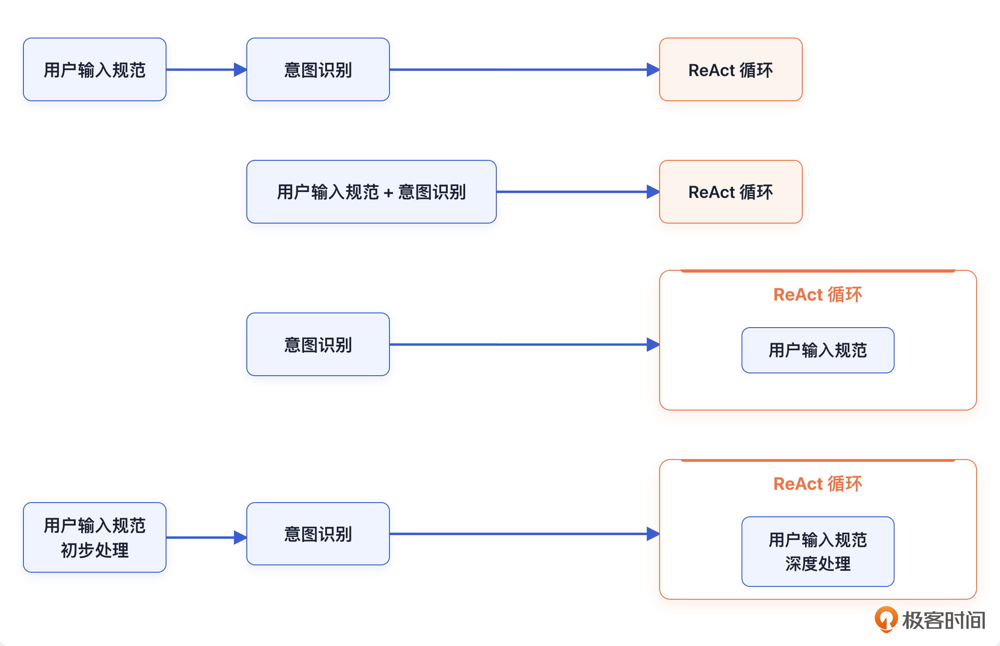

# 明确问题

在“意图识别”这个大的话题下，遇到的第一个问题就是“如何理解用户的输入”。在实践中，用户的输入都是很随便的，正如我们日常说话一样随意。比如：使用代词、缺失主语、口语、主观、黑话。

解决这个问题，就被称为用户输入归一化 / 用户输入规范化 / 理解用户输入。Agent 中的用户输入规范和意图识别这两件事，就类似于传统软件工程理论中的需求分析。

# 基本方案：调 LLM

用户输入规范化这种事情，最简单的解决方案就是调用一下大模型，让大模型去帮你推断。

## 调用 LLM 规范化用户输入的时机



各时机各有其适应场景：
1. 在意图识别之前：越是通用的 Agent、越是面向 C 端的 Agent，这一步就越要独立。
2. 和意图识别一起：用户不多、领域专属的 Agent 可以使用，这一类的 Agent 比较难遇到奇奇怪怪的用户。
3. 在后续执行过程中，如在 ReAct 循环中：这是一个没得选的事情，也就是类似于“最有性价比”这种形容词，是只能在这个阶段实现的。
4. 分阶段：1/2 可以和 3 结合使用，即将用户输入规范化分成初步和深度处理两个阶段：
   1. 初步处理：大部分的用户输入会在这个阶段就规范处理掉。
   2. 深度处理：一旦涉及**严重依赖上下文、工具调用**的，则只能在这个阶段处理。它一般都被嵌入在 ReAct 循环中。

## Prompt：明确职责边界、few-shot、要求检查

以第一种时机为例。

首先，明确职责边界：很多时候大模型“过于自主”，如果你不约束的话，它可能一股脑帮你把输入规范、意图识别之类的事情全部干完了。
- 能做什么：指代消解、省略句补全、病句修正、术语标准化、黑话解释、多义词消歧、判断是否需要澄清、判断是否需要搜索。。。
- 不能做什么：不直接回答用户问题（最容易犯的错误）、不执行工具、不做最终推荐、不判断业务意图、不生成完整方案、不擅自补充事实、不强行猜测低置信内容、不伪造实时信息。。。它只是“翻译层”，不是“执行层”。

其次，可使用 few-shot 把模型拉到稳定的行为模式上。few-shot 就是在 Prompt 里放几个“用户原话 -> 规范化结果”的例子，让模型学会什么该补、什么不能猜、什么情况要澄清。
- `针对每一种用户输入都设计 few-shot` ：覆盖最全，但 token 成本高。
- `线上遇到怪输入再沉淀成 few-shot` ：更实用，按真实 badcase 积累样例。
  - 用户澄清，可以沉淀成样例：当用户说“那个”且上下文存在多个候选时，不要猜，应该先澄清。
  - 用户主动纠正：模型理解错了，用户说“不是，我指的是 xxx”。这是很好的反例样本。
  - 用户确认结果：模型规范化后复述，用户确认“对”。可以入候选池。
  - 工具执行结果验证：比如用户说“查下今天的”，系统发现必须补全城市/对象，否则工具无法执行，这类可以沉淀成“需要澄清”的样例。
  - 人工标注/审核：运营或开发从日志里挑 badcase，手工写出标准规范化结果。
  - 线上失败归因：某类输入反复导致错误路由、错误工具调用，也可以总结成 few-shot。
  - 更准确的流程：
   ```text
   原始怪输入
   -> 保留上下文和模型当时的规范化结果
   -> 通过用户澄清 / 用户纠正 / 执行结果 / 人工审核拿到真值
   -> 抽象成“输入模式”，去掉具体隐私和偶然细节
   -> 写成 few-shot：用户输入、可用上下文、期望输出、禁止行为
   -> 回放验证，确认不会破坏已有 case
   -> 入样例库，后续通过检索注入 Prompt
   ```
- `用检索机制挑 few-shot` ：当样例库很大时，不把所有例子都塞进 Prompt，而是根据当前输入检索最相关的几个注入进去。

例：
```text
你是用户输入规范化器，只负责改写和补全用户输入，不直接回答问题。

示例 1：
用户输入：帮我把那个再跑一下，别太贵
输出：
- 规范化输入：用户希望重新执行上文提到的某个任务，并倾向低成本方案。
- 不确定信息：“那个”依赖上下文解析。
- 处理建议：若上下文中没有明确任务对象，需要澄清。
- 禁止行为：不得自行假设具体任务。

示例 2：
用户输入：这个方案靠谱吗？
输出：
- 规范化输入：用户希望评估上文提到的方案是否可靠。
- 不确定信息：“这个方案”依赖上下文。
- 处理建议：结合上文方案内容分析；若无上下文，需要澄清。
- 禁止行为：不得凭空补全方案细节。

现在处理：
用户输入：别用那个，换便宜点的
输出：
```

最后，检查用户输入是否已经处理完整：
- 检查主谓宾是否完整。
- 检查代词是否完全消解，比如说要求最终输出一个代词消解的表格。代词消解的表格需要作为一个关键事实贯穿在本轮对话的整个处理过程，并且可能进一步影响后续几轮的对话。
- 形容词、极值等是否已经输出了“可量化”的内容。

其他一些比较细碎的点：
- 命名很重要。输出“方案一”这种就容易让用户后续用“方案一”来引用，不如“TCC 方案”这种。这种按名索引 / 查找的最大的优点是能有效**规避大模型推理阶段引用错误**的问题。
- 要求用户澄清：可以要求大模型在无法彻底规范用户输入的时候，比如说代词消解推断不出来人、物、地点等情况下，不要瞎猜，而是引入一个澄清机制。
- 结构化输出：比如指代消解的表格，有一些人会输出一些更加规范的结构，比如说主谓宾三个字段，再加上一些对定状补的解释，例如：“性价比”问题。

# 进阶方案：深度结合上下文

- 结合用户画像。例如说有个人反复讨论《三国演义》电视剧，那么后续在该用户提问《三国演义》的时候就应该倾向于将它解释为电视剧，而不是其他的什么。
- 结合关键事实。这个“关键事实”是一个比较抽象的说法，它包含用户的喜好（和用户画像有重合）、观点、态度，前面几轮 Agent 输出的要点、已被用户认可的点。
- 结合对话历史召回。可以召回对话的摘要，也可以是召回细节。

## 基于属性 + 检索的推理方式

假设用户在假期前要求 Agent 推荐一个适合出游的地方，而后大模型推荐了鸡鸣寺，建议去看樱花。在假期结束之后，用户再次跟 Agent 交流，他输入一句话：“你上次推荐的看樱花的那个地方……”。

难点：
- 时间跨度长。假期前后跨度几天，那么短期记忆基本没了。这个时间段内，用户可能已经产出了很多对话，查找困难。
- 属性指代问题。它比一般的“这个”，“那个”这种指代还多了一层属性有关的匹配。

从实现方案上来说，基本上要借助 RAG 或者其它检索机制，简单来说可以看做是两步：
- 先根据用户输入去历史对话里面召回细节，放入到窗口中。在这里差不多就是用“樱花、旅游”这种内容去检索。
  - 检索可能失败。比如历史记录里原话不是“樱花”，而是“花期”“赏花”“南京春游”；或者那段对话被很多无关对话淹没了。此时，可以先用 LLM 根据用户输入，把指代短语拆成可检索的属性，进行二次结构化检索，比如BM25、向量检索、倒排索引、结构化过滤、rerank 等。

```text
第一层：按用户原话检索
“上次推荐的看樱花的那个地方”

第二层：按结构化属性检索
{
  对象类型: 地点,
  关系: Agent 曾推荐,
  场景: 出游,
  特征: 樱花 / 赏花,
  时间范围: 假期前
}
```

- 大模型基于窗口内容来推断，完成指代消解。在这里就是将“看樱花的那个地方”推理得到“鸡鸣寺”。

## 基于行业画像 + 自我迭代演进的词汇表

行业画像：同样的词汇 / 缩写在不同的行业、领域、上下文里面有不同的含义。在 Prompt 里面带上所处的行业等信息，并且强调大模型要结合行业、领域来解释。

词汇表：在整个系统里面维护一个词汇表，里面是各种词汇、黑话之类的解释，它可以被放在 MySQL 中或者向量数据库中，在输入规范处理之前，先检索一下这个词汇表，将检索结果注入到窗口内，再调用大模型。

更加复杂的操作，则是将不同人、不同多轮对话中频繁出现的一些特殊的词汇沉淀下来，放入到这个词汇表中。这个词汇表可以更进一步做成公共词汇表和用户个人词汇表两个。

难点在于识别词汇，一方面要防止错漏，一方面也要尽量规避误加入。最简单的做法就是通过离线分析多轮对话，先标记一些疑似的词汇，记录出现的次数和基本含义。当一个词汇频繁出现，那么就升级放入到词汇表中:
- 总次数大于阈值，比如说 100。
- 讨论的人超过了 3 个，这可以理解为是公共词汇。
- 连续讨论 10 次等。

## 可量化是一件极为重要的事情

任何一个未量化的形容词都会导致你的 Agent 输出结果出现漂移。

例：
```text
用户输入：推荐一条裤子。
Agent 返回：牛仔裤 A 200 块，休闲裤 B 300 块。
用户输入：帮我推荐一个更有性价比的牛仔裤。
量化：A 同品牌 150~200 元的裤子。
```

很多 Agent 的问题在于处理过于粗暴：一看到“性价比高”，就直接理解成价格低，却忽略了质量、性能、品牌、售后等因素。
