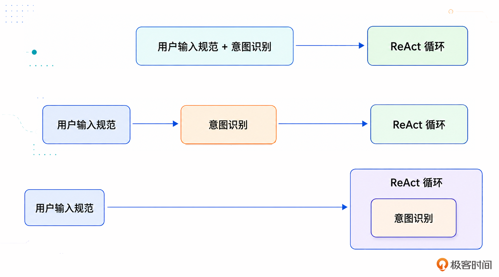

简单来说，一个基础但完整的意图识别系统，至少要包含封闭的候选意图集合、清晰的意图边界、结构化输出 Schema、拒识和澄清。

# 为何要做意图识别：定方向

意图识别就是从一堆枚举里面挑出一个。

意图识别本身在 Agent 构建中是一个非常重要的点：”方向错了，知识越多越反动”。

不同意图对应的提示词和处理流程不同，TAO 这种范式下的 Action 会很不一样，上下文管理也会很不一样。

从理论上来说，当然可以直接在 ReAct 或 TAO 循环里面完成意图识别。也就是说，Agent 一边思考，一边判断用户要做什么。但是从工程实践上来说，大多数系统还是会在进入主流程之前，先做一次独立的意图识别。

第一、意图会影响 Prompt / Spec 加载，决定后面应该加载哪一套业务规范。
- 售前：主要考虑用户预算、使用场景、品牌偏好、历史浏览、商品评分、性价比、是否有活动等。
- 售后：订单状态、是否已发货、是否超过退款期限、商品是否支持退货、是否需要人工审核以及退款路径是什么等。

显然这两个流程的 Prompt / Spec 不一样。

第二，意图会影响上下文组织。
- 售前：上下文里面应该重点放用户画像、价格偏好、历史购买、浏览行为、商品候选集和推荐策略等。
- 售后：主要放用户订单、物流状态、售后政策、支付记录和退款记录等。

如果你在售后场景里面塞一堆用户画像和商品偏好，那就是浪费上下文窗口。所以，意图识别的第二个作用是决定当前上下文窗口里面应该放什么，不应该放什么。

第三，意图会影响工具选择。
- 商品推荐可能调用商品检索工具；
- 订单查询可能调用订单系统；
- 退款申请可能调用售后系统；
- 内容生成可能调用文档生成工具。

如果意图识别错了，工具调用大概率也会错，或者大模型根本选不出合适的工具，导致 Agent 无法继续处理下去。

# 结构化输出

```json
{"intent": "product_recommendation", category: "服装", subcategory: "裤子"}
```

- intent classification：识别用户要进入哪个业务流程。
- Slot Filling：抽取这个流程需要的关键参数。

# 意图识别的时机



- 第一种，和用户输入规范化混在一起。比如系统先对用户输入做规范化，纠正错别字、补全指代、整理成结构化表达，同时顺手识别出用户意图。这种方式在简单系统、小型 Agent、领域专属 Agent 里面比较常见。
- 第二种，在进入 ReAct 或 TAO 循环（思考 Thought - 行动 Action - 观察 Observation）之前，先做一次独立的意图识别。也就是说，用户输入进来后，系统先判断意图，再根据意图加载对应的 Spec、上下文和工具，最后进入后续 Agent 流程。
  - 这样做的好处是边界清晰、可评估、可调试，也更符合工程化思路。
- 第三种，直接在 ReAct 或 TAO 循环里面完成意图识别。这种方式更加灵活，但是也更难控制。因为模型一边思考、一边决定任务方向，调试起来会更复杂。大多数时候这种方式都是和 Slot Filling 结合在一起的。

# 提示词：枚举(含出口)、边界、参数、few-shot

意图识别提示词的核心是让模型在一个受控的业务意图空间里完成分类和结构化输出。

首先，也是最重要的一点：定义清楚候选意图。不要让模型自己发明意图，不允许无中生有。可以在意图识别之后，结合代码校验来进一步防止大模型无中生有。理论上来说应该提供两个出口：unsupported（拒识），unclear（意图之间有混淆，又或者参数可能不够，这时候要考虑的是澄清。）

其次，定义清楚意图边界。现两个意图之间可能在语义上比较接近的时候，一定要澄清这一部分。

第三，定义清楚意图的参数，也就是 Slot Filling 里面的 Slot，槽位。并且要对识别之后的参数进行检查。

比如对于商品推荐意图，可以要求大模型抽取：
```text
category：商品类目，例如手机、笔记本电脑、耳机、跑鞋。
sub_category：更细分类目，例如游戏本、轻薄本、降噪耳机。
budget_min：最低预算。
budget_max：最高预算。
usage_scenario：使用场景，例如办公、游戏、通勤、送礼。
brand_preference：品牌偏好……
```

还可以进一步描述这些参数是否必选，以及可选参数的默认值等。此外还有一些也是可以考虑的通用的参数：
```text
must_have_features：必须满足的特性。
nice_to_have_features：加分项。
hard_constraints：硬约束。 // 大模型无论如何都要满足的。
soft_preferences：软偏好。 // 软约束类似，但是它是“努力”满足。也就是大模型要将这些因素考虑在内，但是如果发现没办法满足的情况下，则可以不满足。不过大多数时候我建议你的 Agent 在没有满足部分软约束的情况下，要明确告知用户，以提升用户体验。
```

另外：
- 可加入置信度参数 confidence，以方便后续流程确定是否识别成功。
- 可加入 missing_slots 字段，方便模型多轮尝试尽量补足（但不强行无中生有地补）。

最后，加入 few-shot。不需要很多，关键是覆盖容易混淆的边界。如果你的意图确实非常容易搞混，那么你可以在 few-shot 里面加入正反两方面的例子，明确界定边界。

```
用户输入:“3000 以内有什么手机推荐，主要拍照好一点？”
输出：{
  "intent": "product_recommendation",
  "slots": {
    "category": "手机",
    "budget_max": 3000,
    "usage_scenario": "拍照",
    "soft_preferences": ["拍照好一点"]
  },
  "need_clarification": false
}
```

# 常规的三层意图识别解决方案

## 代码层

UX、 关键字提取 / 正则匹配(”继续“、”下一步“等)、规则引擎（用户的输入符合某一个规则，又或者上下文中的状态符合某个规则，则被认为是某一个意图，它通常会依赖于用户输入规范化之后的结果。）

快、准、便宜、稳定。但参数需要在后续流程中再识别。

## 调用轻量级大模型

在代码层不能匹配意图之后采用。

适合处理那些不太适合写死规则，但也不需要深度推理的输入。

大多数时候用户的输入、意图都是非常明确的，轻量级大模型就有很好的表现，准确率高的同时，响应速度还很快。

让模型额外输出置信度，可以设计成：
- 置信度高于 0.85：直接接受；
- 置信度在 0.6 到 0.85 之间：进入仲裁或澄清；
- 置信度低于 0.6：交给下一层深度推理模型。

注意：
- 阈值不是拍脑袋定的，而是要根据测试集和线上效果调出来。
- 大模型输出的 confidence 不一定是真正的概率。它更多是一个“自我判断分数”。所以实践中最好结合规则命中、向量相似度、历史准确率等信号一起判断。

## 调用深度推理大模型

在调用轻量级大模型也无法识别意图后采用。

主要是用来支持一些复杂场景，包括：
- 表达非常复杂；
- 强依赖上下文；
- 多轮对话中发生意图切换；
- 用户输入包含多个意图；
- 需要根据上下文补全隐含信息。

比如用户这样输入：
> 比如说用户输入这种：我刚才那个项目还是太普通了，你能不能按照阿里 Java 后端的要求，帮我改成更像核心项目，然后顺便告诉我面试官可能会怎么追问？

# 评估意图识别的效果

Top-K Accuracy：系统每次返回 K 个候选意图，只要标准答案在这 K 个候选意图里面，就算命中。

实践中，基本就看 Top1 Accuracy。
- 专属领域的 Agent：尤其是领域比较小的，用户输入也比较规范的，那么意图识别的准确率做到 99% 以上。
- 通用 Agent：这种其实意图识别准确率很难做到特别高，一般 Top1 在 80%-90% 之间。

只有在一些比较特殊的业务领域中会进一步考虑其它指标：
- 分意图准确率。假设系统 80% 的请求都是商品推荐，那么模型全部猜商品推荐，也可能有不错的整体准确率。
- 拒识和澄清指标：
  - 拒识准确率：应该拒识的时候，系统是否拒识。
  - 误拒率：本来能处理，却被系统错误拒识。
  - 漏拒率：本来应该拒识，却被系统强行归类。
  - 澄清触发准确率：缺少关键信息时，是否正确追问。
  - 澄清后收敛率：追问之后，用户任务是否顺利推进。
- Slot Filling 的指标：
  - 槽位准确率：抽出来的槽位值是否正确。
  - 槽位召回率：用户提供的信息有没有被抽出来。
  - 必填槽位完整率：启动流程必须的槽位是否齐备。
  - 槽位更新准确率：多轮对话中新信息是否正确覆盖旧信息。
  - 约束识别准确率：硬约束和软偏好是否识别正确。
- 结合用户当前这一轮的输入来评估上一轮的意图识别准确率。比如用户输入：“不是，我不是这个意思。”或者“你理解错了。”这些都可以作为上一轮意图识别失败的信号。一般来说，可以在下一轮对话开始的时候，先评估上一轮对话的效果，其中一个评估项目就是意图识别是否准确。
- 还可以进一步叠加考察整个流程的指标来评价意图识别。比如说整体任务成功率，显然如果意图识别都不准确，那么任务也不可能成功了。

在设计测试集的时候，你至少要考虑覆盖以下这些场景：
- 标准表达：用户明确说出了系统支持的意图，这个用来测试最基础的意图识别能力。
- 口语化表达：模仿用户随意说话，输入可能是病句，可能有缺省，可能有指代。这种测试一般要结合用户输入规范一起测试。
- 槽位缺失输入：用户的输入中少了一部分意图所需的参数，例如前面那个缺失价格区间的例子。
- 拒识：会被意图识别明确拒绝的输入。
- 容易混淆的样本：也就是要考虑两个相近的输入，但是意图又有很大差别的场景。

在设计测试集的时候，还可以考虑的场景：
- 跨轮补充：多轮对话里，用户经常不会一次说完，需要多轮对话合并在一起才能得出所有的参数值。
- 识别约束：用户的输入是带有硬约束或者软约束的，要确保意图识别的时候将这些约束识别出来了。
- 意图切换：用户在多轮对话里面，从一个意图跳转到了另外一个意图。
- 多意图输入。
